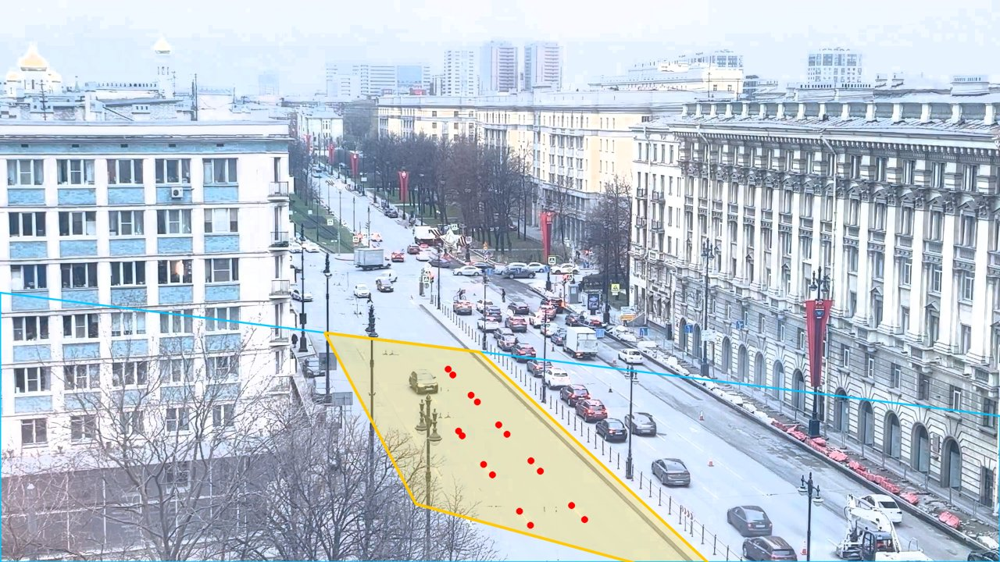
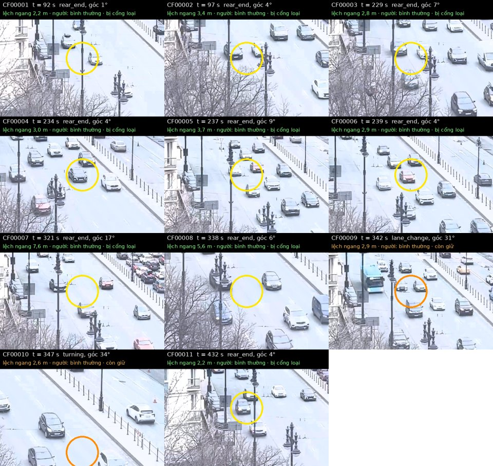
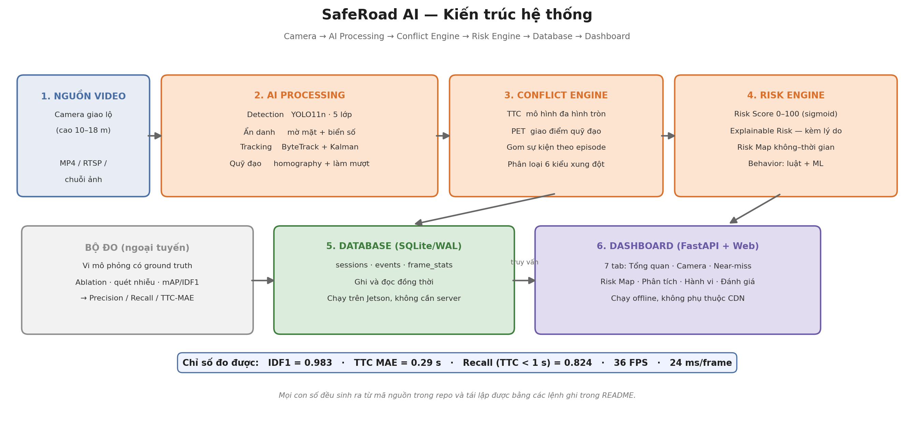

# SafeRoad AI

**Hệ thống AI phát hiện near-miss, phân tích rủi ro và xây dựng bản đồ an toàn giao thông**

Cuộc thi Sáng tạo trẻ Quốc gia trong lĩnh vực Trí tuệ nhân tạo 2026 - Bảng C

[](https://github.com/dangkhoi-dev/SafeRoad-AI/actions/workflows/ci.yml)
[]()
[]()

---

## Vấn đề

Quản lý an toàn giao thông ở Việt Nam đang chạy theo cơ chế **phản ứng**: một giao
lộ chỉ được coi là "điểm đen" sau khi đã đủ số vụ tai nạn được thống kê. Trong khi
đó, trước mỗi vụ tai nạn có hàng trăm tình huống **suýt va chạm** mang cùng cơ chế
nguy hiểm nhưng kết thúc may mắn - diễn ra ngay trước ống kính camera đã lắp sẵn.

**SafeRoad AI biến luồng video giám sát sẵn có thành chỉ báo xung đột giao thông
định lượng** (TTC, PET, mức rủi ro). Xung đột là chỉ báo, không phải tai nạn: hệ
thống tách riêng near-miss, chồng thân xe do sai số đo và nghi va chạm, và mọi cảnh
báo cần người rà soát trước khi dùng để ra quyết định.

---

## Bản cải tiến Chặng 1

Phản hồi ba yêu cầu của hội đồng - chi tiết và minh chứng trong
[`docs/BaoCaoCaiTien_SafeRoadAI_Chang1.pdf`](docs/BaoCaoCaiTien_SafeRoadAI_Chang1.pdf):

1. **Video thật và chất lượng phát hiện** - thêm video đại lộ thật có nhãn bbox + ID
   (ghép nhãn CVAT bị cắt đoạn), hiệu chuẩn camera có kiểm tra chéo
   (`saferoad calibrate`), bảng detection → tracking → cảnh báo trên cùng một video,
   báo nhầm/bỏ sót theo giờ, tinh chỉnh YOLO11n theo từng camera với train/test chia
   theo thời gian (đại lộ và MVTI), công cụ rà soát nhãn của người + Cohen's kappa
   (`scripts/score_reviews.py`), demo **chạy pipeline thật** trên video tải lên.
2. **PET và near-miss** - tách PET ngoại suy và PET đo từ mốc vào/ra vùng xung đột,
   lưu 4 mốc thời gian; xử lý quỹ đạo song song và xe đã qua giao điểm; phân loại
   near-miss / chồng thân xe / nghi va chạm; trình mô phỏng có vật lý va chạm. Mỗi lỗi
   có ca tái hiện trong `tests/test_pet_and_contact.py`.
3. **Đánh giá nhất quán** - một luồng đếm sự kiện với 5 đẳng thức tự kiểm, mọi tỉ lệ
   kèm tử/mẫu số, sửa cờ hành vi 305/307 quỹ đạo, ablation bỏ từng khối + cộng dồn
   trên cùng mẫu, lưới 3 mật độ × 3 góc camera × 3 điều kiện ánh sáng, log cấu hình có
   mã băm.

---

## Kết quả đo được

Toàn bộ số dưới đây do `scripts/build_readme_tables.py` ghi từ `data/outputs/*.json`;
chạy lại được bằng các lệnh ở mục [Tái hiện](#tái-hiện).

<!-- AUTO:RESULTS:START -->
**Mô phỏng có đáp án** (300 s, seed 42, 64 xung đột chuẩn = 54 near-miss + 10 va chạm; detector mô phỏng nhiễu 1,5 px, bỏ sót 3%, seed 17):

| Chỉ số | Kết quả (tử/mẫu) |
|---|---:|
| Precision | 0,533 (49/92) |
| Recall | 0,766 (49/64) |
| F1 | 0,628 |
| TTC MAE | 0,203 s |
| PET đo - MAE | 0,031 s (n=30) |
| PET ngoại suy - MAE | 0,131 s (n=35) |
| Recall near-miss / va chạm | 0,759 (41/54) / 0,800 (8/10) |
| Tracking IDF1 / MOTA / đổi ID | 0,983 / 0,965 / 142 |
| Quỹ đạo bị gắn cờ hành vi | 0,478 (131/274) |

Đối soát: 133 sự kiện phát ra = 133 trên dashboard = 41 ngoài vùng đánh giá + 92 được chấm (49 TP + 43 FP). Đẳng thức tự kiểm: đều đúng.

Ablation bỏ từng khối (cùng mẫu, cùng seed):

| Cấu hình | Precision | Recall | F1 |
|---|---:|---:|---:|
| Bản đầy đủ | 0,533 (49/92) | 0,766 (49/64) | 0,628 |
| Bỏ homography | 0,091 (1/11) | 0,016 (1/64) | 0,027 |
| Bỏ làm mượt quỹ đạo | 0,156 (49/315) | 0,766 (49/64) | 0,259 |
| Bỏ gom episode | 0,378 (14/37) | 0,219 (14/64) | 0,277 |
| Bỏ cổng tốc độ tiếp cận | 0,331 (47/142) | 0,734 (47/64) | 0,456 |
| Bỏ PET | 0,623 (38/61) | 0,594 (38/64) | 0,608 |
| Bỏ PET đo (chỉ PET ngoại suy) | 0,480 (49/102) | 0,766 (49/64) | 0,590 |
| Bỏ cổng khoảng cách | 0,238 (56/235) | 0,875 (56/64) | 0,375 |
| Bỏ cổng cùng làn | 0,538 (49/91) | 0,766 (49/64) | 0,632 |

**Video thật - detection → tracking → cảnh báo trên cùng một video** (cảnh báo so với tham chiếu = cùng thuật toán chạy trên quỹ đạo người gán nhãn):

| Dữ liệu / detector | mAP@0,5 | mAP@0,5 (bỏ hộp nhỏ) | Recall @ngưỡng chạy | IDF1 | Cảnh báo / tham chiếu | P so tham chiếu | R so tham chiếu | Báo nhầm/giờ | FPS |
|---|---:|---:|---:|---:|---:|---:|---:|---:|---:|
| Đại lộ (Kaggle), 300 s, YOLO11n gốc | 0,095 | 0,100 | 0,084 | 0,097 | 0 / 1 | - (0/0) | 0,000 (0/1) | 0,0 | 15,3 |
| Đại lộ, test 220-300 s, YOLO11n gốc | 0,052 | 0,054 | 0,054 | 0,021 | 0 / 0 | - (0/0) | - (0/0) | 0,0 | 15,3 |
| Đại lộ, test 220-300 s, YOLO11n tinh chỉnh | 0,202 | 0,219 | 0,453 | 0,223 | 0 / 0 | - (0/0) | - (0/0) | 0,0 | 13,7 |
| MVTI, YOLO11n gốc | 0,208 | 0,209 | 0,278 | 0,235 | 1 / 0 | 0,000 (0/1) | - (0/0) | 44,2 | 15,4 |
| MVTI, test 57-81 s, YOLO11n gốc | 0,196 | 0,199 | 0,273 | 0,072 | 0 / 0 | - (0/0) | - (0/0) | 0,0 | 15,3 |
| MVTI, test 57-81 s, YOLO11n tinh chỉnh | 0,710 | 0,717 | 0,612 | 0,262 | 0 / 0 | - (0/0) | - (0/0) | 0,0 | 15,2 |

MVTI chỉ có 19 phương tiện và phần lớn đứng trong khung suốt 81 s, nên trong đoạn test 14/17 xe đã gặp lúc huấn luyện (model có thể đã nhớ chúng). Chấm riêng 3 xe chỉ xuất hiện sau phần huấn luyện (500 hộp): mAP@0,5 0,322 (gốc) → 0,574 (tinh chỉnh).

"Bỏ hộp nhỏ": hộp chuẩn nhỏ hơn `detection.min_box_area` (200 px² với đại lộ) được coi là vùng bỏ qua theo quy ước COCO, vì pipeline cố ý không xử lý vật thể xa như vậy. Người đi bộ trên video đại lộ có kích thước trung vị 8×23 px - ở đầu vào 640 px chỉ còn khoảng 3×8 px nên YOLO11n gần như không thấy.

**Cảnh báo tham chiếu trên video đại lộ theo từng bước lọc** (300 s, quỹ đạo người gán nhãn):

| Bước | Cấu hình | Cảnh báo | /giờ | Near-miss / chồng thân / nghi va chạm |
|---|---|---:|---:|---:|
| A | Toàn khung hình, cấu hình cũ | 1956 | 23448,6 | 1139 / 541 / 276 |
| B | + bỏ cặp hai người đi bộ | 1794 | 21506,5 | 1061 / 487 / 246 |
| C | + chỉ xét mặt đường ≤ 65 m | 232 | 2781,2 | 143 / 58 / 31 |
| D | + kẹp vận tốc xe đứng yên | 117 | 1402,6 | 89 / 15 / 13 |
| E | + chỉ lòng đường đã hiệu chuẩn | 2 | 24,0 | 2 / 0 / 0 |
| F | + cổng cùng làn (cấu hình dùng) | 1 | 12,0 | 1 / 0 / 0 |

Phần lớn cảnh báo ở bước A-D là sai số hình học (xe đỗ ở xa có bbox rung hơn 1 m; lòng đường bên phải nằm ngoài vùng có điểm hiệu chuẩn), nên cảnh báo chỉ được phân tích trong lòng đường đã hiệu chuẩn (vàng):



**Chạy đầu-cuối trên đoạn chưa từng dùng** (đại lộ 300-741 s, không nhãn, detector tinh chỉnh, 14,9 FPS). Bản trước cổng cùng làn phát 11 cảnh báo (89,7/giờ), danh sách để người rà soát ở `data/outputs/review_candidates_street_heldout.csv`; bản hiện tại phát 2 cảnh báo trong 442 s (16,3/giờ).

**Cảnh báo so với nhãn xung đột do người rà soát** (`scripts/score_reviews.py`; nhãn gán trên bản trước cổng cùng làn). Kappa "-" khi cả hai người chỉ dùng một nhãn (không xác định), khi đó đọc cột trùng nhãn; bỏ sót/giờ "-" là tập chưa được xem lại toàn bộ video:

| Tập | Ứng viên | Trùng nhãn | Kappa (5 lớp / có-không) | P | R | Báo nhầm/giờ | Bỏ sót/giờ |
|---|---:|---:|---:|---:|---:|---:|---:|
| real | 1 | 100% | - / - | 0,000 (0/1) | - (0/0) | 44,2 | - |
| street | 2 | 100% | - / - | - (0/0) | - (0/0) | 0,0 | - |
| street_finetuned_test | 3 | 100% | - / - | 0,000 (0/2) | - (0/0) | 89,7 | - |
| street_heldout | 11 | 100% | - / - | 0,000 (0/11) | - (0/0) | 89,7 | 0,0 |
| street_pretrained_test | 1 | 100% | - / - | - (0/0) | - (0/0) | 0,0 | - |

Trên 441 s chưa từng dùng, cả 11 cảnh báo của bản trước cổng đều được người rà soát đánh giá là giao thông bình thường (89,7 báo nhầm/giờ); hai người xem lại toàn bộ video và không thấy xung đột thật nào, nên chưa đo được Recall.

**Phân tích lỗi và cổng cùng làn** (`scripts/measure_lateral_offset.py`, `scripts/lane_gate_check.py`). Đo lại từng cảnh báo: tại khung hình cảnh báo, hai xe lệch ngang 2,2-7,6 m, tức là đi cùng chiều ở hai làn khác nhau; luật cũ chỉ xét góc giữa hai vectơ vận tốc nên gọi đó là đâm đuôi. Cổng mới: cặp có góc tiếp cận dưới 30° và không xe nào đang rẽ gấp (> 45°/s) chỉ được xét khi lệch ngang dưới 1,75 m (nửa làn 3,5 m đã giả định khi hiệu chuẩn, không dò). Kết quả trên đoạn này: 11 → 2 cảnh báo, 89,7 → 16,3 báo nhầm/giờ; 9 cảnh báo bị loại đều đã được người đánh giá là bình thường; 2 cảnh báo còn lại (lane_change 31°, turning 34°: góc tại đỉnh trên 30° nên cổng không áp dụng) cũng đã bị đánh giá là bình thường. Trên mô phỏng có đáp án, bỏ cổng này cho Precision 0,538 (49/91), Recall 0,766 (49/64); có cổng: 0,533 (49/92), 0,766 (49/64) - Recall không đổi, thêm 1 báo nhầm. Trên lưới 27 ô (1107 xung đột chuẩn): TP 816 → 814, cảnh báo được chấm 1732 → 1718. Vì cổng được rút ra từ chính đoạn 441 s này nên con số sau sửa không phải phép thử độc lập; cần một đoạn video mới có nhãn người.



Hiệu chuẩn video đại lộ: 16 điểm mốc từ vạch kẻ, sai số fit 0,306 m, leave-one-out 0,740 m (tối đa 1,684 m) - ước lượng, chưa đo thực địa.

Giới hạn còn lại được báo cáo nguyên trạng: hai video thật đã có nhãn người đều là giao thông bình thường, nên chưa đo được Recall trên video thật, và báo nhầm/giờ sau khi thêm cổng cùng làn mới được kiểm trên chính đoạn đã dùng để phân tích lỗi; hiệu chuẩn video đại lộ là ước lượng từ vạch kẻ đường chứ chưa đo thực địa và chỉ phủ lòng đường bên trái, nên cảnh báo chỉ được phân tích trong vùng đó; người đi bộ trên video đại lộ quá nhỏ cho YOLO ở 640 px; hai bộ video thật không có xe máy; mô phỏng dày đặc va chạm hơn thực tế; "ánh sáng" trong lưới thực nghiệm là hồ sơ chất lượng detector.

<!-- AUTO:RESULTS:END -->

---

## Kiến trúc



| Khối | Chức năng | Công nghệ |
|---|---|---|
| 1. Nguồn video | Thu nhận luồng hình ảnh | MP4 / RTSP / chuỗi ảnh |
| 2. AI Processing | Phát hiện · ẩn danh · theo vết · quỹ đạo mặt đất | YOLO11n · ByteTrack · Kalman · Homography |
| 3. Conflict Engine | TTC · PET ngoại suy + PET đo · gom episode · phân loại kết cục | Mô hình đa hình tròn |
| 4. Risk Engine | Risk Score · Explainable Risk · bản đồ nhiệt | Sigmoid có trọng số |
| 5. Database | Lưu trữ bền vững, đọc/ghi song song | SQLite chế độ WAL |
| 6. Dashboard | 9 tab, có chạy thử video và rà soát nhãn | FastAPI · HTML/Canvas thuần |

---

## Cài đặt

```bash
git clone https://github.com/dangkhoi-dev/SafeRoad-AI.git
cd SafeRoad-AI
python -m venv .venv
.venv\Scripts\activate             # Linux/macOS: source .venv/bin/activate
pip install -e ".[dev,docs]"
python scripts/download_assets.py  # trọng số YOLO11n (~5,6 MB)
pytest tests -q
```

---

## Tái hiện

```bash
# Mô phỏng có đáp án: kết quả chính + đối soát + ablation + quét nhiễu (~15 phút CPU)
python -m saferoad simulate --duration 300 --seed 42
python -m saferoad train-behavior         # tầng ML của bộ phân loại hành vi (đặc trưng v2)
python -m saferoad evaluate
python -m saferoad evaluate-grid          # lưới mật độ × camera × ánh sáng (~20 phút)

# Video đại lộ (Kaggle): ghép nhãn, hiệu chuẩn, chấm detection → tracking → cảnh báo
python -m saferoad prepare-street --annotations data/raw/mvti/merged_annotations.json
python -m saferoad calibrate --points configs/calib_street.yaml \
    --frame data/processed/street/street_labeled_0_300s.mp4 \
    --image docs/assets/calib_street.jpg --out data/outputs/calibration_street.json
# YOLO11n gốc trên toàn bộ 300 s có nhãn
python -m saferoad evaluate-real --config configs/street.yaml --weights models/yolo11n.pt \
    --no-db --no-overlay --source data/processed/street/street_labeled_0_300s.mp4 \
    --ground-truth data/processed/street/street_groundtruth.pkl \
    --calibration-report data/outputs/calibration_street.json \
    --out data/outputs/evaluation_street.json
# Cảnh báo tham chiếu theo từng bước lọc (vì sao chỉ phân tích lòng đường đã hiệu chuẩn)
python scripts/street_reference_sensitivity.py

# Tinh chỉnh YOLO11n: train 0-210 s, bỏ trống 210-220 s, test 220-300 s (~35 phút CPU)
python scripts/export_street_yolo.py --video data/processed/street/street_labeled_0_300s.mp4 \
    --ground-truth data/processed/street/street_groundtruth.pkl --out data/yolo_street
python scripts/train_street_yolo.py
# So sánh gốc / tinh chỉnh trên đúng đoạn test (thay --weights và --out cho từng bản)
python -m saferoad evaluate-real --config configs/street.yaml --weights models/saferoad_street_yolo11n.pt \
    --start-frame 6600 --no-db --no-overlay --source data/processed/street/street_labeled_0_300s.mp4 \
    --ground-truth data/processed/street/street_groundtruth.pkl \
    --calibration-report data/outputs/calibration_street.json \
    --out data/outputs/evaluation_street_finetuned_test.json

# Chạy đầu-cuối trên 441 s chưa từng dùng + xuất danh sách để người rà soát
# (danh sách nào đã có nhãn người thì được giữ nguyên; bản chạy lại ghi vào data/outputs/reruns/)
python -m saferoad run --config configs/street.yaml --no-overlay \
    --source data/processed/street/street_heldout_300_741s.mp4 \
    --output data/outputs/street_heldout \
    --review-csv data/outputs/review_candidates_street_heldout.csv

# MVTI
python -m saferoad prepare-real --root data/raw/mvti --view Infrastructure
python -m saferoad evaluate-real --config configs/mvti.yaml --no-db
# Tinh chỉnh trên MVTI: train khung 0-1499, bỏ trống 1500-1699, test 1700-2440 (~30 phút CPU)
python scripts/export_street_yolo.py --video data/processed/mvti/infrastructure.mp4 \
    --ground-truth data/processed/mvti/infrastructure_groundtruth.pkl --out data/yolo_mvti \
    --prefix mvti --train-end 1500 --test-start 1700 --train-step 5 --val-step 15
python scripts/train_street_yolo.py --data data/yolo_mvti/data.yaml --epochs 15 --name mvti \
    --out models/saferoad_mvti_yolo11n.pt --results-csv data/outputs/train_mvti_yolo11n_results.csv
# Gốc / tinh chỉnh trên đúng đoạn test; --seen-before chấm thêm riêng xe chưa gặp lúc train
python -m saferoad evaluate-real --config configs/mvti.yaml --weights models/yolo11n.pt --no-db --no-overlay \
    --start-frame 1700 --seen-before 1500 --out data/outputs/evaluation_mvti_pretrained_test.json
python -m saferoad evaluate-real --config configs/mvti.yaml --weights models/saferoad_mvti_yolo11n.pt --no-db --no-overlay \
    --start-frame 1700 --seen-before 1500 --out data/outputs/evaluation_mvti_finetuned_test.json

# Chấm nhãn người rà soát (sau khi có >= 2 file labels_<bộ>_<tên>.csv)
python scripts/score_reviews.py --missed street_heldout=0

# Phân tích lỗi trên đoạn 441 s: đo độ lệch ngang từng cảnh báo của bản trước cổng cùng làn,
# rồi so trước/sau (ghi data/outputs/lane_gate_check.json, ảnh docs/assets/heldout_lane_gate.jpg)
python scripts/measure_lateral_offset.py --results data/outputs/archive_before_lane_gate/street_heldout_results.json \
    --video data/processed/street/street_heldout_300_741s.mp4 --out data/outputs/lateral_offset_street_heldout.json
python scripts/lane_gate_check.py --figure

# Cập nhật bảng số trong README và báo cáo cải tiến
python scripts/build_readme_tables.py
node scripts/build_improvement_report.js
```

Video đại lộ gốc là 4K HEVC; bản 1080p dùng ở trên tạo bằng FFmpeg:

```bash
ffmpeg -i data/raw/own-footage/input-001.MOV -t 300.3 -vf scale=1920:1080 -c:v libx264 -crf 23 -an data/processed/street/street_labeled_0_300s.mp4
ffmpeg -ss 300.3 -i data/raw/own-footage/input-001.MOV -vf scale=1920:1080 -c:v libx264 -crf 25 -an data/processed/street/street_heldout_300_741s.mp4
```

---

## Rà soát nhãn của người

```bash
python -m saferoad serve --results data/outputs/results.json
# mở http://127.0.0.1:8000 → tab "Rà soát nhãn", mỗi người gán độc lập rồi bấm "Lưu nhãn"
python -m saferoad review-score --candidates data/outputs/review_candidates_street.csv \
    --labels data/outputs/labels_street_khoi.csv data/outputs/labels_street_anh.csv \
    --duration 300 --extra-missed 0
```

Nhãn: `near_miss`, `collision`, `normal`, `overlap_artifact`, `unclear`. κ < 0,6 thì
thống nhất lại cách hiểu protocol rồi gán lại ([`docs/protocol_near_miss_v2.md`](docs/protocol_near_miss_v2.md) §8).

---

## Demo

* **Chạy thật (Modal, CPU):** tab *Chạy thử video* - tải video lên, máy chủ chạy
  YOLO → ByteTrack → TTC/PET → Risk, xem tiến độ, video overlay, cảnh báo và bảng đối
  soát của chính lần chạy đó. Deploy: `modal deploy scripts/deploy_modal.py`. Cùng máy
  chủ đó đóng gói bằng `Dockerfile` cho mọi nền tảng chạy container (Hugging Face Spaces
  bản PRO: `scripts/deploy_hf_space.py`).
* **Chạy tại máy:** `python -m saferoad serve --demo` → http://127.0.0.1:8000.
* **Trang tĩnh (Vercel):** `node scripts/build_static_site.mjs` - chỉ hiển thị kết quả tính sẵn.

---

## Toàn bộ lệnh

| Lệnh | Chức năng |
|---|---|
| `saferoad simulate` | Sinh kịch bản + nhãn chuẩn (near-miss, va chạm) + bảng kiểm tra kịch bản |
| `saferoad run` | Chạy pipeline trên một video (`--review-csv` để xuất danh sách rà soát) |
| `saferoad evaluate` | Kết quả chính, đối soát sự kiện, ablation, quét nhiễu, log cấu hình |
| `saferoad evaluate-grid` | Lưới mật độ × góc camera × ánh sáng, so baseline |
| `saferoad prepare-street` | Ghép nhãn CVAT của video đại lộ thành quỹ đạo liên tục |
| `saferoad prepare-real` | Dựng video + nhãn từ MVTI |
| `saferoad calibrate` | Homography từ điểm mốc + sai số fit / leave-one-out / kiểm tra |
| `saferoad evaluate-real` | Detection → tracking → cảnh báo trên cùng video thật |
| `saferoad review-score` | Kappa + Precision/Recall + báo nhầm/giờ theo nhãn người |
| `saferoad serve` | Dashboard (`--demo` để bật chạy thử video) |
| `saferoad anonymize` | Ẩn danh video (làm mờ mặt, biển số) |
| `saferoad train-behavior` | Huấn luyện bộ phân loại hành vi |

---

## Cấu trúc thư mục

```
SafeRoad-AI/
├── src/saferoad/
│   ├── conflict/        # TTC, PET ngoại suy, PET đo (encroachment.py), gom episode, kết cục
│   ├── simulation/      # vi mô phỏng có vật lý va chạm + camera pinhole + nhãn chuẩn
│   ├── evaluation/      # scoring (đối soát), experiment, ablation, grid, real_conflicts
│   ├── geometry/        # homography, hiệu chuẩn (calibration.py), làm mượt quỹ đạo
│   ├── data/            # MVTI, nhãn CVAT dạng video (cvat_video.py)
│   ├── dashboard/       # FastAPI + giao diện + chạy thử video (jobs.py)
│   └── ...              # detection, tracking, risk, behavior, privacy, storage, pipeline
├── configs/             # default · synthetic · mvti · street · calib_street
├── data/outputs/        # kết quả JSON (minh chứng số liệu), archive_v1/ = số liệu bản cũ
├── docs/                # báo cáo cải tiến, báo cáo v1, protocol v2, giấy phép dữ liệu
├── scripts/             # báo cáo, README, xuất YOLO, deploy Modal / Hugging Face
├── tests/               # pytest
└── Dockerfile           # bản demo chạy thật
```

---

## Tài liệu

| Tài liệu | Nội dung |
|---|---|
| [`docs/BaoCaoCaiTien_SafeRoadAI_Chang1.pdf`](docs/BaoCaoCaiTien_SafeRoadAI_Chang1.pdf) | Báo cáo cải tiến Chặng 1 (bản Word: `.docx` cùng tên) |
| [`docs/protocol_near_miss_v2.md`](docs/protocol_near_miss_v2.md) | Định nghĩa near-miss, PET hai cách tính, ba kết cục, quy trình rà soát |
| [`docs/dataset_license.md`](docs/dataset_license.md) | Nguồn dữ liệu và điều kiện bản quyền |
| [`docs/BaoCao_SafeRoadAI_BangC.pdf`](docs/BaoCao_SafeRoadAI_BangC.pdf) | Báo cáo kỹ thuật bản trước (v1) - số liệu đã được thay bằng báo cáo cải tiến |

---

## Giấy phép

Mã nguồn: **MIT**. Ultralytics YOLO dùng **AGPL-3.0** - hợp lệ cho nghiên cứu và dự
thi; thương mại hoá cần giấy phép doanh nghiệp hoặc thay detector (giao diện
`BaseDetector` đã tách riêng).

Trích dẫn bắt buộc khi dùng UCSD Highway Traffic Database: A. B. Chan and
N. Vasconcelos, "Probabilistic Kernels for the Classification of Auto-Regressive
Visual Processes", *IEEE CVPR*, San Diego, 2005.

---

## Nhóm thực hiện

**Trần Phan Đăng Khôi** (KHMT, đội trưởng) · **Lại Thế Mạnh Anh** (Kỹ thuật Robot) · **Trần Huỳnh Hân** (Quản trị Kinh doanh)
